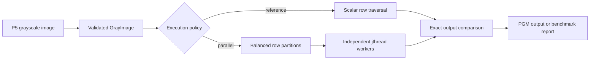

# Architecture and design review

## Data flow

`GrayImage` owns one contiguous row-major byte buffer and validates positive,
non-overflowing dimensions. Both implementations apply the selected integer
3×3 Gaussian or box kernel with clamped borders, so equality is byte-for-byte
rather than an image-quality tolerance.

The parallel path rejects requests above a 256-thread safety cap, limits active
workers to image height, divides rows as evenly as possible, and gives each
worker an exclusive output range. Workers share the read-only input but never
write the same output byte, so no mutex is required. `std::jthread` joins
automatically on exceptional paths, and the normal path explicitly destroys
the worker group before the output can be moved into the return value.

The optional benchmark worker pool creates a fixed set of threads once and
dispatches successive blur calls by generation. Every worker acknowledges each
generation, including workers with no assigned rows, before the result returns.
Calls are serialized intentionally: this experiment isolates per-call thread
startup from steady-state dispatch without claiming a general task scheduler.

## Design decisions checked before implementation

- **Role signal:** modern C++, memory layout, algorithms, thread partitioning,
  benchmarking, and correctness target NVIDIA software roles without claiming
  electrical or accelerator experience.
- **Smallest credible scope:** one real file format and two exact kernels expose
  I/O validation, boundaries, parallel work decomposition, and measurement.
- **Reference before optimization:** the scalar function is the correctness
  oracle and is timed independently from the multithreaded path.
- **Reproducibility:** the benchmark uses a fixed xorshift input, alternating
  execution order, medians, exact comparison, and an output checksum.

## Boundaries

This is shared-memory CPU parallelism. The default path starts threads for every
call; the optional fixed pool accepts only one blur at a time and has no queue,
work stealing, cancellation, or concurrent submission. The project supports
only fixed 3×3 Gaussian and box kernels and does not use SIMD, tiled caches,
color formats, JPEG/PNG codecs, GPUs, or CUDA. Those are possible experiments
only after preserving the scalar equivalence tests and recording
hardware-specific measurements.
